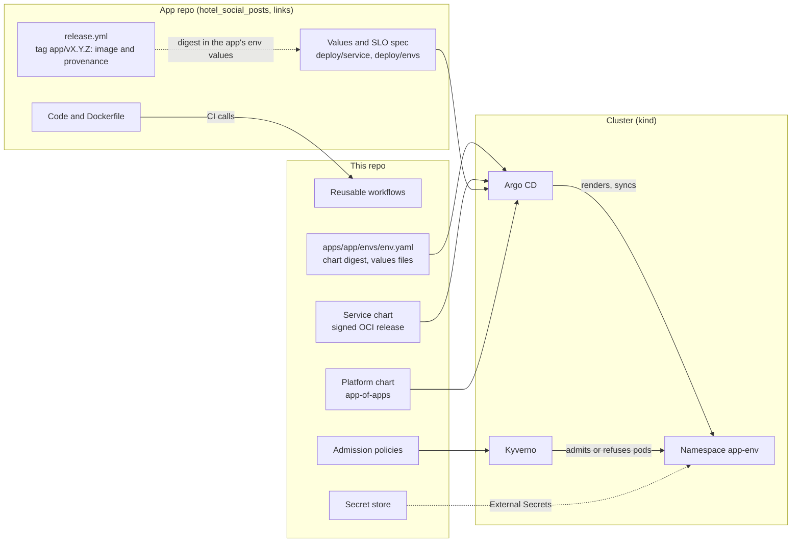
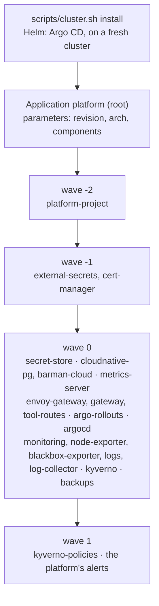
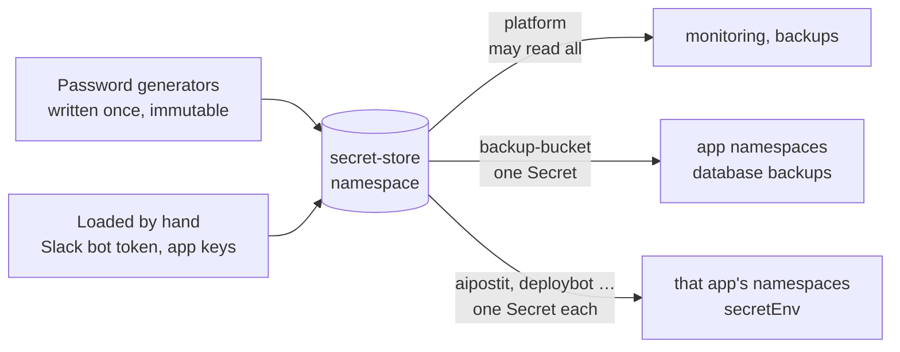

# Platform design

What this repo owns, how its parts fit and why they are shaped this way. How to operate
them is in [RUNBOOK.md](RUNBOOK.md); how to change them is in [CLAUDE.md](../CLAUDE.md).

The platform's parts were designed inside the first app, shortly, and described in its
design doc (links' `apps/shortly/docs/DESIGN.md`). They moved here with platform plan
Phase 3; this is their description, as they are on `main`. An app's own design (its
requests, data, SLOs, capacity, the end-to-end drills its CI runs) stays in the app's repo,
and so do the measurements and incidents behind the choices below, in links' doc.

## Overview

An app team changes its code, its values and the release each environment runs. Everything
else is the platform's: how the app is checked and built, the chart that turns its values
into Kubernetes objects, what the cluster admits, and what runs beside it.

| Part | Where | An app uses it by |
| --- | --- | --- |
| Reusable workflows | `.github/workflows/reusable-*.yml` | Calling them from its CI, pinned by this repo's commit SHA |
| Service chart | `charts/service/` | Its values files; the chart's digest is pinned here, in `apps/<app>/envs/<env>.yaml` |
| The app's environments | `apps/` | A folder, reviewed here |
| Platform chart | `deploy/argocd/platform/` | Nothing to do: it is what the cluster runs beside the app |
| Admission policies and the deploy gate | `deploy/policies/`, `scripts/verify-image.sh` | Releasing from its own `release.yml` at an `<app>/vX.Y.Z` tag |
| Secret store | `deploy/secrets/` | `secretEnv` and `database.cluster` in its values |

**The repo is an API.** Apps pin this repo's commits (workflows; links' `platform.lock`)
and the chart's digests, so a change reaches an app only when its pin moves, in a PR whose
CI proves the app on it. A change an app must react to goes expand, migrate, contract,
never in one PR. `main` is never rewritten and a published chart version is never replaced.
What does not wait for a pin is the cluster itself: Argo CD syncs the platform chart, the
policies and `apps/` from `main` within a minute of a merge.

## Reusable workflows

`workflow_call` workflows hold the checks every app's CI runs, so a fix to a check is made
once: one check per language, and one image workflow for every language (the app contract is
the image's behaviour, not its language). This repo's own tests run through the Python check,
so it is exercised on every PR here; the Java and Rust checks are exercised by
app-template's `java-template` and `rust-template`.

| Workflow | Does | Inputs |
| --- | --- | --- |
| `reusable-python-check.yml` | `uv sync --locked` (fails on a stale lock), ruff format and lint, mypy, pytest with a coverage floor | `working-directory` (an app in a domain repo: `apps/<app>`), `coverage-min` (90), `typecheck-paths`, `helm-version`, `fetch-depth` |
| `reusable-java-check.yml` | `./mvnw verify` on a pinned Temurin JDK, Maven dependencies cached. The project's build defines the checks (formatting, compile, tests) and enforces the coverage floor it is passed as `-Dcoverage.min` | `working-directory`, `java-version` (21), `coverage-min` (0.90) |
| `reusable-rust-check.yml` | `cargo fmt --check`, `cargo clippy -D warnings`, the tests through `cargo llvm-cov` with a line-coverage floor, all `--locked` (fails on a stale `Cargo.lock`). The toolchain is the project's `rust-toolchain.toml`, so CI and the Dockerfile build with the same compiler; `target/` cached | `working-directory`, `coverage-min` (90), `coverage-ignore` (`src/main\.rs$`: the entry point is the smoke test's) |
| `reusable-image.yml` | Builds the image, scans it with Trivy (HIGH and CRITICAL with a fix available: failing on unfixable ones trains people to ignore the scanner), runs the app's smoke test against it | `context`, `smoke-command` (the image's tag is in `$IMAGE`) |
| `reusable-kind-e2e.yml` | One app in one environment on the platform its repo pins (`scripts/kind-e2e.sh`): kind with the platform at the caller's `platform.lock` commit (`cluster.sh up`, no backups), the image built from the app's repo, its namespace as the `apps` ApplicationSet makes it, placeholders for the keys its pods read, the chart at the caller's pin with the values files `apps/<app>/envs/<env>.yaml` lists. Checks every workload Ready, the front door on each hostname, every metrics target up and the PrometheusRules loaded. About 15 minutes: an app runs it on lock and chart pin PRs, not every PR. A caller that isn't the app (the platform's own CI) names the app's repo and commit, the platform commit and, for an app the platform doesn't deploy, its values files | `app`, `env`, `context`, `chart`; optional `platform-ref`, `app-repository`, `app-ref`, `values-files` |

Each takes `run`: with `run: false` the job reports success without doing the work. A
docs-only PR then passes its required checks in seconds; a workflow-level paths filter
would leave them pending forever. The caller decides what counts as docs-only.

**Not here: the release workflow.** A reusable workflow becomes the signer named in the
provenance it attests, and the admission policy and the deploy gate identify a release by
its signer: the app repo's own `release.yml`. So each app repo keeps its release workflow.

Actions are pinned by commit SHA, tokens are least-privilege (`permissions`,
`persist-credentials: false`), and Dependabot keeps the pins fresh.

## The service chart

One Helm chart, `charts/service`, deploys every app. The app's values say what is specific
to it (its name, image, env list, hostnames); the chart's defaults are production-shaped.

| Value | Renders |
| --- | --- |
| (always) | Deployment (`maxUnavailable: 0`, `maxSurge: 1`), Service, startup, liveness (`/healthz`) and readiness (`/readyz`) probes, a `preStop` sleep before SIGTERM, topology spread. Pods run as UID 10001, non-root, read-only root filesystem, no capabilities, seccomp `RuntimeDefault`, no ServiceAccount token |
| `autoscaling`, `podDisruptionBudget` | An HPA on CPU (and no `replicas` on the workload, which would reset the live count at every sync); a PDB when the minimum replica count is above 1. Rendering fails if `maxReplicas × config.dbPoolSize` exceeds `autoscaling.maxDbConnections` |
| `networkPolicy` | Ingress to the app port from `httpFrom`, to the metrics port from Prometheus only; egress to DNS, the database and `extraEgress`, nothing else |
| `gateway` | An HTTPRoute attaching the release to the platform's Gateway by hostname |
| `canary` | An Argo Rollout in place of the Deployment (below) |
| `monitoring` | A ServiceMonitor; from the one `clusterWide` release per cluster (prod), the app's PrometheusRules and dashboards, the platform's SLO dashboard among them |
| `migrations` | A Job running the app's migration command before new pods start; a failure stops the release |
| `database.cluster` | The app's own Postgres on CloudNativePG: a `Cluster` `<release>-db` (never pruned by Argo CD), WAL archived continuously and a base backup hourly to the platform's bucket, network rules both ways. The app reads its URL from the Secret `<release>-db-app` |
| `cronJobs`, `workers` | A CronJob or a Deployment per entry from the release image, with the app's env; labelled apart, so the HPA and the PDB don't count them; a network policy of their own |
| `redis` | A single Redis 8 with an append-only file, reachable only from the chart's own pods; no password: the network policy is the boundary |
| `secretEnv` | An ExternalSecret copying the app's keys from its store into `<release>-env` |
| `rbac.clusterRead` | A ServiceAccount the app's pods run as, with its token, and a ClusterRole and ClusterRoleBinding `<namespace>-cluster-read`: `get`, `list`, `watch` on ServiceMonitors, PodMonitors, Probes, PrometheusRules and namespaces, nothing else. With it, the app's NetworkPolicy allows egress to the API server: `networkPolicy.apiServerTo` (default: the private ranges) on TCP `networkPolicy.apiServerPort` (6443). Only for an app on the platform's list (below) |

**Cluster-wide read access is the platform's to give.** `rbac.clusterRead` is a value in the
app's repo, which changes without a PR here, so nothing in this repo's CI can be what stops
an app from setting it. The app's AppProject is: Argo CD applies a cluster-scoped object
only if `apps/<app>/project.yaml` lists it by name, and fails the whole sync otherwise, so
an app that sets the value without being allowed keeps running what it ran. The list of
apps that may is `CLUSTER_READ_APPS` in `scripts/check-apps.py`; `tests/test_cluster_read.py`
holds every project to it (no cluster-scoped kind beside its namespaces unless the app is
listed, then exactly those two objects per namespace), and check-apps reports an app that
sets the value off the list, or without its project's entry, where its values are next
rendered in CI. An admission policy would enforce the same list a second time; the project
already does, with no new moving part.

**The way to the API server is by address.** With `rbac.clusterRead` the chart adds the
egress rule itself, so an app's values never carry a cluster's addresses. The API server is
a host-network endpoint (on kind the control-plane node, port 6443, behind the `kubernetes`
Service's 10.96.0.1:443), so no pod or namespace selector matches it; only an `ipBlock`
does. And the rule names 6443, not 443: kindnet's policy engine (kube-network-policies)
judges a pod's connection to the node in the `input` hook, after kube-proxy's DNAT, so what
it sees is the node's address and port (`nft list table inet kindnet-network-policies` on
the node; Kubernetes leaves before-or-after-rewrite to the implementation). The node's
address is Docker's to assign and differs per laptop, so the default is the three private
ranges: it closes the internet and every other port, and admits any private address on
6443 (a pod listening there, if its own policy lets the app in). No other policy in the
platform restricts egress, so there was no rule to copy. Narrower, for kind, would be
Docker's address pools (`172.16.0.0/12`, `192.168.0.0/16`), which leave out the pod and
Service ranges; that needs a value the platform sets for every app (the ApplicationSet),
which it doesn't do yet. Another cluster's engine may see another address and port
(Cluster contract, [network policy](#c-netpol)).

**The env list is the app's.** The chart renders `env` as it is, in order: which variables
an app reads is not the chart's business. Each entry is a template, so it can read
`config.*`, which an environment's file overrides.

**Order under Argo CD.** Sync waves put the secret env and the database first (the
database held until its Cluster is healthy), then the migration, then the app.

**Its behaviour is its golden renders.** `tests/<app>/<env>.golden.yaml` holds what the
chart renders for each fixture (shortly, and minimal apps for each optional part). CI
diffs them, so a refactor must leave them byte for byte the same, and an intended change
shows as the manifests Argo CD will apply, not as template edits.

**Releases.** A `service/vX.Y.Z` tag publishes the chart to
`oci://ghcr.io/easypeasyops/charts/service` with Sigstore provenance, and the GitHub
Release's notes hold its digest (README, Releasing the service chart). Semantic versioning
since 1.0.0: a change an app must react to is a major version (`CHANGELOG.md`). Apps are
pinned by digest, one environment per PR, staging first; `scripts/check-apps.py` verifies in
CI that each pinned digest is a release whose provenance verifies and that the chart
renders with the app's values fetched from its repo.

**SLO rules.** `scripts/gen_slo_rules.py` turns an app's SLO spec into recording rules and
multi-window burn-rate alerts (each needing a minimum of bad events, so a quiet hour can't
page on one slow request), as a values file the chart ships. A generator because the rules
are too repetitive to write by hand, and small enough to need no extra binary or CRD. Its
output's bytes are in every app's goldens, so its dependencies are pinned in the script.
The window is 30 days (the generator accepts no other: the burn-rate factors assume it),
but a rule can only look back as far as Prometheus keeps: 10 days, or less once
`retentionSize` or a fresh volume cuts it (RUNBOOK, Prometheus data). So
`slo:sli_error:ratio_rate30d`, and the "Error budget remaining" built on it, is the error
ratio of the days Prometheus has, not of 30: an incident older than that has left the
budget, which shows it restored. The burn-rate alerts are unaffected (their longest window
is 3 days). The retention stays at 10 days (PT-27: 30 days of today's series are 17 to
39 GB on the laptop, by how long it is awake), so the dashboard says what it shows instead:
"Budget looks back" is the days of data there are, beside the budgets.

On low traffic the budget is a ratio of a handful of requests. Nothing guards it the way
the alerts' minimum of bad events guards them: aipostit's prod had 25 valid requests in
the window and 4 slow ones, and with a 0.99 objective allowing 0.25 of a request, its
latency budget read -1501% while no alert fired (PT-62). The budget stays as it is (it is
right, and servicemonitor reads it), but the rules also record the window's valid events,
`slo:sli_events:increase30d`, and "Requests in the budget" shows them beside it with the
bad ones (`slo:sli_error:ratio_rate30d` times that). So a budget far below 0 reads as how
many requests it really is (PT-70).

The rules are one set per app, for all its environments: every rule selects by the app's
`job` and aggregates `by (namespace)`, and only the one `clusterWide` release (prod, or a
tool's single environment) ships them, so staging and prod get separate budgets and burn
alerts from one copy of the rules (PT-61, Emrah, 2026-11-16). Two copies would record every
series twice. Alertmanager routes each environment's alerts by `namespace`: staging's go to
its own channel and never notify anyone (deploy/kind/monitoring-values.yaml). So an
environment without an SLO series has had no requests in the window; it doesn't mean it has
no rules.

### Canary releases

Probes and a rolling update only stop a release whose pods never become ready. A release
that starts, passes its probes and then fails requests needs a canary: with
`canary.enabled` the Rollout gives the new version each of `weights` (10%, then 50%) of
the Gateway's traffic in turn, and moves on only if analysis passes.

- **Traffic split:** the HTTPRoute has two backends, the stable and canary Services; Argo
  Rollouts sets their weights through its Gateway API plugin, so the split is per request,
  whatever the pod count. Stable pods stay up during the steps: an abort is the weight
  going back to 0.
- **Analysis** runs on the canary's pods only (Prometheus labels each pod's series with
  its pod-template hash), over a 1-minute rate: `traffic` (too little proves nothing, so
  it fails rather than passes), `error-ratio` (5xx share, one bad measurement aborts) and
  the app's `latencyChecks` (p99 per route, coarse on purpose). Thresholds are absolute: a
  comparison against stable needs enough traffic on both sides.
- **Synthetic traffic:** a k6 Job runs beside each analysis step, through the Gateway, with
  the app's script. Part of the analysis, so every canary gets it, whoever started it. A
  prod with real users turns it off.
- **Rollbacks skip the steps** (`rollbackWindow`), and so does a first install.
- **Argo CD and Argo Rollouts share the objects.** The ApplicationSet's template ignores
  the route's weights and the Services' hash selector, or self-heal would undo a canary
  mid-flight.
- Not covered: a problem that shows only at full load or after a long time, and
  migrations, which run before any canary pod and must stay backward compatible.

## Apps under Argo CD

`apps/applicationset.yaml` generates one Application, `<app>-<env>`, per
`apps/<app>/envs/<env>.yaml`. The env file pins the service chart by digest and lists the
values files to layer from the app's repo. So onboarding an app is a folder here, and every
app gets the same template.

- **The platform owns how, the app owns what.** The chart and its pin are here; the values
  and the image digest are in the app's repo, read from its `main`. Promoting a release is
  a PR there; moving a chart version is a PR here.
- **The namespace comes with the Application.** Argo CD creates `<app>-<env>` with the
  restricted Pod Security Standard enforced, the labels `easypeasyops.github.io/app` and
  `/env`, and its baseline, `deploy/app-namespace/` (default-deny ingress).
- **Everything that serves every app selects namespaces by that label:** the admission
  policies, the Gateway's app listener, the bucket's store, each app's own store. A new app
  needs no edit there. A label added to the template reaches an existing namespace only at
  its Application's next sync, and doesn't trigger one: sync, and check
  `kubectl get ns -l <label>`, before anything selects by it (platform #61 didn't, and
  shortly's front door was down for 3 minutes).
- **Least privilege per app.** `apps/<app>/project.yaml` is the app's AppProject: the
  service chart, its repo and this one as sources; its namespaces as destinations; and no
  cluster-scoped kind except those namespaces, by name (and, for an app on the cluster-read
  list, the two objects of `rbac.clusterRead`: The service chart, above).
- **Auto-sync, prune and self-heal:** git is the only way in, a hand edit is reverted,
  and a revert of the PR is the rollback. The ApplicationSet leaves `syncPolicy` alone once
  an Application exists, so break glass (auto-sync off on one Application) still works.
- **Deleting never deletes the app:** no finalizers, and `preserveResourcesOnDeletion`.

Pull, not push: the cluster needs no credentials in CI, and drift is corrected, not just
avoided. Argo CD polls GitHub (a laptop can't receive a webhook), so a merge lands within
about a minute.

### Tools in this repo

A tool the platform itself ships (servicemonitor, PT-51) is an app like any other, without
a repo of its own: `tools/<app>/` holds what an app keeps in its domain repo's
`apps/<app>/` (`app/`, `tests/`, `Dockerfile`, `pyproject.toml` and `uv.lock`,
`deploy/service/values.yaml`, `deploy/envs/<env>.yaml`), and its image is
`ghcr.io/easypeasyops/platform/<app>`. It still goes through the whole contract: its own
checks in CI, a released service chart pinned by digest in `apps/<app>/envs/`, and the
admission policies.

- **Not under `apps/<app>/`.** Argo CD's git file generator globs greedily (`*` crosses
  `/`), so `apps/servicemonitor/deploy/envs/ops.yaml` would match the ApplicationSet's
  `apps/*/envs/*.yaml`, be read as an env file, and fail the generator for every app
  (`tests/test_namespaces.py` keeps the pattern's matches to the env files).
- **Its checks are its own.** The platform's ruff run excludes `tools/`; CI runs each
  tool's lint, types and tests in its folder with its lock and its coverage floor, builds,
  scans and smoke-tests its image, checks its SLO rules against this commit's generator and
  renders its values with the released chart. On a pull request these run only when
  `tools/`, a workflow they use or the generator changed.
- **No `platform.lock`.** The tool and the platform are one commit: the workflows are
  called locally, and a platform change that breaks the tool fails the same PR.
- **Released from this repo.** `release.yml` builds, scans, pushes and attests the image
  from an `<app>/vX.Y.Z` tag on a commit of `main` whose `tools/<app>/pyproject.toml` has
  that version, then runs `scripts/verify-image.sh` on the digest. The admission policy
  needs no entry for it: it accepts `ghcr.io/easypeasyops/<repo>/<app>` signed by
  `<repo>`'s `release.yml` at `<app>`'s tag, and `platform` is one more repo. The chart
  keeps `release-chart.yml` and its `service/v*` tags, which `release.yml` leaves out
  (`tests/test_release_workflows.py`).

`tools/dbcanary/` (PT-106) is a tool with no code: only its `deploy/` values. It is a
database the platform owns, so backups are proven without waiting for an app to need one.
Its writer runs `psql` from the database's own image, which the image allowlist admits
in every app namespace.

## The platform chart

`deploy/argocd/platform/` is a Helm chart whose templates are Argo CD Applications
(app-of-apps), one per platform component. `scripts/cluster.sh up` bootstraps Argo CD with
Helm on a fresh cluster, applies the platform root and the apps root, and waits; nothing
else is put in the cluster by hand. From then on Argo CD manages its own install too (the
`argocd` child).

`up` is two steps, split where a cluster stops being kind's (PT-116). `cluster.sh create`
makes what only kind needs: the cluster, a LoadBalancer implementation (cloud-provider-kind,
which gives a `LoadBalancer` Service an address on the kind network as a cloud's would; its
own Gateway API and Ingress controllers off), and the front door's forwarders to the
laptop's ports. `cluster.sh install` is everything above, on whatever cluster the
kube context points at, and names nothing kind-specific. Another cluster gets its own
`create` (a cloud's Terraform, PT-114) and the same `install`; what one must provide is the
[Cluster contract](#cluster-contract).

| Choice | Why |
| --- | --- |
| The root is a Helm chart | Git can't know a cluster's CPU architecture (the Argo Rollouts plugin is a per-architecture binary), which commit CI is testing, or which components a small cluster skips. They are Helm parameters, set by `cluster.sh` |
| Upstream charts pulled by digest from OCI, values in git beside them | The version says what it is, the digest that it can't change; `tests/test_platform.py` checks each version still resolves to its digest. Values are `deploy/kind/*-values.yaml`, read at the root's revision |
| Waves by what a child needs | The AppProject before the children it limits; External Secrets and cert-manager before the charts that read their Secrets and certificates; the policies and the Argo CD alerts after the slow charts whose webhook and CRDs they need. What needs only fast CRDs (the Gateway) stays in wave 0 and lets the sync retry cover the race |
| The Prometheus operator after its CRDs | Inside the monitoring child, the operator, Prometheus and Alertmanager are in wave 1, the stack's CRDs in wave 0: the operator checks its CRDs once, at start-up, and never runs the controller of one that wasn't there yet (a fresh cluster's Prometheus then never starts). A retry can't cover that race; a wave can |
| Retries order a fresh cluster | A child that has never synced doesn't hold its wave, so on a new cluster all are created at once; one whose dependency isn't ready fails and retries with a short backoff |
| A `platform` AppProject, kept from git | The platform must create CRDs, ClusterRoles and webhooks; apps must not. Neither project may deploy into the other's namespaces |
| No finalizer on the children | Deleting a child, or the root, orphans its resources instead of deleting the monitoring stack or the admission webhook |
| Server-side apply and diff | Several charts' CRDs are too big for client-side apply, and fields other controllers write (webhook CA bundles) are not drift |
| Argo CD under itself, bootstrapped by Helm | The usual pattern: Helm installs it once, then its `argocd` Application owns the same pin and values, so a change to them lands on merge like any other (PT-109; until then one needed `cluster.sh up`). A bad change can stop the thing that would sync its fix, so: its CRDs are never pruned, `cluster.sh up` leaves it to the Application but `ARGOCD_HELM=1` re-installs it with Helm, and the RUNBOOK (Argo CD broke itself) says when. Helm's release records and field ownership are removed once the Application has adopted it, as for the charts before it (PT-104) |
| metrics-server vendored | The release manifest, byte for byte, with its SHA-256; a kustomize patch adds the kind-only flag ([resource metrics](#c-metrics)) |

### Profiles

kind's values (`deploy/kind/*-values.yaml`) are every cluster's base. A cluster that differs
gets a profile, `deploy/profiles/<name>/` (PT-119): `install` takes it as `PROFILE=<name>`
and does two generic things with it, never a branch on its name. It adds the profile's
`platform.yaml` to the root's values (which components the cluster skips), and sets the
root's `profile` parameter, so each chart child layers the profile's file of the same
name over kind's (`ignoreMissingValueFiles`: most charts need none). Without a profile,
nothing is added and kind renders as before. A difference that a values file can't
express is a [Cluster contract](#cluster-contract) leak: it is fixed in the contract or
recorded there.

### Components

Each platform component, the Application (or script) that installs it, and its role. Versions
and digests are in `deploy/argocd/platform/values.yaml`; values in `deploy/kind/`.

| Component | Application · namespace | Role |
| --- | --- | --- |
| Argo CD | `argocd` (bootstrapped by `cluster.sh` with Helm) · `argocd` | GitOps: syncs the platform chart, the policies and `apps/` from `main`, and renders each app's service chart into its namespaces |
| External Secrets Operator | `external-secrets` · `external-secrets` | Copies each secret from the secret store to the namespaces that use it, from ExternalSecrets; its generators make the passwords |
| Secret store | `secret-store` · `secret-store` | The source of every platform and app secret, and the ClusterSecretStores that bound who may read which (below, The secret store) |
| cert-manager | `cert-manager` · `cert-manager` | Issues the certificates CloudNativePG and the Barman Cloud plugin talk mutual TLS over |
| CloudNativePG | `cloudnative-pg` · `cnpg-system` | Operator that runs each app's Postgres from the `Cluster` its chart renders: failover, base backups, point-in-time recovery |
| Barman Cloud plugin | `barman-cloud` · `cnpg-system` | CloudNativePG's backups (base backups and WAL) to the bucket |
| SeaweedFS | `backups` · `backups` | The S3 bucket the backups go to, reachable only by backup and restore pods (kind only: a cloud bucket elsewhere, [bucket](#c-bucket)) |
| Envoy Gateway | `envoy-gateway` · `envoy-gateway-system` | Gateway API implementation: runs the Envoy proxies of the front door and ships the Gateway API CRDs |
| Gateway | `gateway` · `gateway` | The front door: one Gateway, routed by hostname, with an `http` listener for apps and a `tools` one for the platform's UIs |
| Tool routes | `tool-routes` · `argocd` | HTTPRoutes for Argo CD, Grafana, Prometheus and Alertmanager on the `tools` listener |
| Argo Rollouts | `argo-rollouts` · `argo-rollouts` | Prod's canary releases, shifting traffic through the Gateway API traffic-router plugin and judging each step by analysis |
| metrics-server | `metrics-server` · `kube-system` | Resource metrics for `kubectl top` and the HorizontalPodAutoscalers |
| kube-prometheus-stack | `monitoring` · `monitoring` | Prometheus Operator, Prometheus, Alertmanager (to Slack, by namespace), Grafana and kube-state-metrics: each app's ServiceMonitors, rules and dashboards come with its chart |
| VictoriaLogs | `logs` · `monitoring` | Keeps every pod's log lines and the cluster's events, queried from Grafana |
| Log collector (vlagent) | `log-collector` · `log-collector` | Sends every pod's log lines from the node to VictoriaLogs (Pod Security `privileged`: reads the node's files) |
| Event exporter | `event-exporter` · `event-exporter` | Writes every Kubernetes event as a log line, so events outlive the API server's hour |
| node-exporter | `node-exporter` · `node-exporter` | The node's CPU, memory and disk for Prometheus (`privileged`: reads the node's files) |
| Blackbox exporter | `blackbox-exporter` · `monitoring` | Asks each hostname through the front door every minute, as a user would |
| Kyverno | `kyverno` · `kyverno` | Admission control: the webhook that runs the admission policies |
| Admission policies | `kyverno-policies` · `kyverno` | Release provenance and the image allowlist for app namespaces (below, Admission policies) |
| Provenance canary | `provenance-canary` · `provenance-canary` | Every 15 minutes, a dry-run Pod with a released image, so a policy that refuses releases is noticed before a deploy |
| Chaos drill | `chaos-drill` · `monitoring` | Every Monday, kills the External Secrets controller's pod and keeps it unscraped until its alert reaches Alertmanager, then checks both come back (RUNBOOK, The chaos drill) |
| Platform AppProject | `platform-project` · `argocd` | What the platform's Applications may deploy, and where (wave -2) |
| The platform's alerts | the root (`templates/monitoring.yaml`) · component namespaces | Scrapes, probes and PrometheusRules that watch the components above (wave 1) |

What the children are for:

- **Front door.** One Gateway (Gateway API, served by Envoy Gateway), routed by hostname.
  Gateway API rather than Ingress because weighted backends are in the spec, which the
  canary needs. Two listeners: `http` admits routes from app namespaces only, `tools`
  (Argo CD, Grafana, Prometheus, Alertmanager, on its own port) from `argocd` and
  `monitoring` only, so no namespace can capture another's hostname and no tool is reachable
  on the users' listener. An app that is a tool (the ServiceMonitor page) is added to
  `tools` by its namespace's name, never by a label, and its route names the listener (the
  service chart's `gateway.sectionName`), so it isn't served on `http` as well. The proxies'
  Service is type `LoadBalancer`, as on a cloud: the cluster's load balancer gives it an
  address and the Gateway reports that address (PT-117,
  [LoadBalancer](#c-loadbalancer)). On kind the load balancer is cloud-provider-kind's, an
  Envoy container on the kind network (`kindccm-*`). The laptop can't reach that network
  (Docker Desktop's VM), and cloud-provider-kind publishes a load balancer only on random
  host ports, so one forwarder container per listener carries 127.0.0.1:8080 and :8090 to
  it by its container's name (kind only): the part a cloud's DNS record plays. They outlive
  releases, sleep and a new load balancer address, which a `kubectl port-forward` doesn't.
- **Monitoring and logs.** kube-prometheus-stack: the operator's CRDs make scraping, rules
  and dashboards part of each app's chart. Alertmanager routes by namespace to Slack.
  VictoriaLogs keeps every pod's log lines, sent by a collector, and the cluster's events,
  which an exporter writes as its own log lines (the API server keeps them an hour; no
  second way into the store); node-exporter reports the
  node's CPU, memory and disk. Those two read the node's files, so each runs alone in a
  namespace of its own, the only two at Pod Security `privileged`. Argo CD is scraped and alerted on too (tickets,
  not pages): with GitOps, a sync that silently stops is a deploy that silently never
  happens. So is the log pipeline: logs that stop arriving fail nothing either, until the
  day they are needed. And External Secrets (warnings): a sync that fails leaves a stale
  Secret and no error. And cert-manager (warnings): a renewal that fails leaves a
  certificate that works until the day it expires. And Kyverno (warnings): with its one
  admission pod down, no Pod can be created in an app's namespace. And CloudNativePG
  (warnings): its operator down, or a database whose last base backup is over a day old,
  for every app's database from one rule rather than one per app. And Argo Rollouts
  (warnings): its controller down, or a canary aborted by an analysis that errored (it
  couldn't measure) rather than failed, the platform's to fix. And a route with no
  backend, read from the HTTPRoute's status through kube-state-metrics (custom resource
  state) rather than from Envoy: the proxy counts its own 5xx per listener only, and only
  when someone asks, while the status names the route and kube-state-metrics already runs.
  The dashboards' deploy marks are read the same way, from each Argo CD Application's last
  sync: Argo CD's own metrics name no revision, and this needs no Grafana API token, which
  Argo CD's notifications into Grafana would. And each hostname, asked for through the
  proxies every minute by a blackbox exporter, as a user would: everything else that watches
  an app goes around the Gateway, and a quiet app's broken route burns no SLO budget. The
  hostnames are a list in git (Prometheus can't discover an HTTPRoute), which CI checks
  against the apps' rendered routes. Details: RUNBOOK.
- **The chaos drill** shows an alert works by setting it off: a promtool test proves a rule's
  expression, not that the metric it reads still exists, that it reaches Alertmanager or
  that the component comes back. One component to start with, whose absence breaks
  nothing that runs (External Secrets' controller: Secrets keep their values); not
  Kyverno's admission webhook or the front door. Its alert waits 10 minutes and a deleted
  pod is back in seconds, so the drill kills the pod once, behind a NetworkPolicy that
  keeps Prometheus out until the alert fires. It doesn't scale to zero, which Argo CD's
  self-heal would undo, and it doesn't delete each new pod as it appears: that churned 3-4
  pods a second and most of the node's CPU (PT-110, run 1). The price: for those 10
  minutes the controller runs, unseen, rather than being gone. A CronJob, so it runs where
  the cluster runs, with the standard library's Python (no image of our own) and RBAC
  narrowed by an admission policy to the controller's pods and that one NetworkPolicy. A
  failed drill is a failed Job, which the stack's `KubeJobFailed` reports like any other.
- **Databases and backups.** CloudNativePG runs each app's Postgres from the `Cluster` its
  chart renders: failover, base backups and point-in-time recovery from an operator
  instead of a hand-rolled StatefulSet and dumps. Backups go through the Barman Cloud
  plugin, which talks to the operator over mutual TLS (hence cert-manager), to a bucket in
  its own namespace (SeaweedFS in kind, [bucket](#c-bucket)), reachable only by backup and restore pods.
- **Argo Rollouts**, with its Gateway API traffic-router plugin, pinned by version and
  checksum. Upstream publishes no checksums: ours were computed when pinned, which guards
  against a later swap, not a bad original.

## Admission policies and the deploy gate

Two layers enforce one rule, that our images run only as releases:

1. **`scripts/verify-image.sh`**, the deploy gate an app's deploy and promote scripts run:
   a clear error before anything changes.
2. **Kyverno**, at the API server: the same rule for every other path (`kubectl`, a
   compromised laptop, a hand-edited digest).

The rule is keyed by identity, not by a list of apps. An image
`ghcr.io/easypeasyops/<repo>/<app>` must be referenced by digest and carry SLSA provenance
signed (Sigstore, keyless, logged in Rekor) by `easypeasyops/<repo>`'s `release.yml`
running at an `<app>/vX.Y.Z` tag. So CI builds, forks and branches don't qualify, one repo
can't vouch for another's images nor one app for another's, and a new app is covered with
no policy edit. `tests/test_admission_policies.py` runs the policies through the Kyverno
CLI (offline cases and the real registry) and asserts the gate and the policy agree.

| Policy | Rule | In kind |
| --- | --- | --- |
| `require-release-provenance` (ImageValidatingPolicy) | The rule above, for every container of a Pod (init and ephemeral included) in an app namespace, and for the Pod templates of Deployments, StatefulSets, Jobs, CronJobs, ReplicaSets and DaemonSets | Deny |
| `app-allowed-images` (ValidatingPolicy) | Pods in an app's namespaces run only that app's release, or the images the chart and its drills bring: Postgres 17, Redis 8, k6, CloudNativePG's. In kind, also the app's own local build (`<app>:dev`, `<app>:e2e`; [egress](#c-egress)) | Deny |

- **They need each other.** The first looks only at our images, so alone it is dodged by
  running some other image; the second closes that. Local builds are how the cluster is
  developed, so they pass through one named exception (`localBuild`): the namespace's own
  app's name with a `:dev` or `:e2e` tag, nothing in front, checked per image. A real
  cluster drops it ([egress](#c-egress)).
- **Tags are refused, not resolved** (`mutateDigest: false`): what was verified is what runs.
- **Fail closed.** The gate refuses without `gh`, the network or an attestation; the
  policy's webhook refuses new Pods if Kyverno, the registry or Rekor can't be reached.
  Running pods are not affected. `INSECURE_SKIP_VERIFY=1` skips the gate only, loudly.
- **Admission only, never in the background.** Kyverno's reports controller otherwise
  re-verifies every running image against the registry and Rekor, which cost about a core
  on the kind node and slowed every request. An image can't change after admission.
- **Kyverno ImageValidatingPolicy (CEL)** rather than Sigstore's policy-controller: Kyverno
  also runs the allowlist, and its CLI tests the same engine offline.

A policy change says in its PR which images it newly admits or refuses.

## The secret store

No secret is in git, and none is made by a script. The `secret-store` namespace holds the
source of every secret; External Secrets copies each to where it is used.

| Choice | Why |
| --- | --- |
| A store inside the cluster (External Secrets' Kubernetes provider) | No secrets server to run, unseal or back up on a laptop. A real cluster points the ClusterSecretStores at a secret manager and no consumer changes ([secret backend](#c-secrets)) |
| Several ClusterSecretStores, each with its own reader | A store's conditions say which namespaces may use it, not which Secret each may read. So what the app namespaces can reach is bounded by the reader's Role: `backup-bucket` may get the bucket's keys only, an app's store that app's one Secret only, and only namespaces labelled with that app may use it |
| Generated values written once, into an immutable Secret | `refreshPolicy: CreatedOnce` so a resync never rotates a password everything uses; `immutable: true` because a recreated ExternalSecret's first sync would otherwise overwrite it silently. A value is replaced only by deleting it |
| Consumers derive the rest | The ExternalSecret beside the chart that reads it templates the user name or config file around the stored value, and syncs before the workload |
| Loaded by hand what can't be generated | Slack's bot token or an app's API key comes from somewhere else: `scripts/load-slack.sh` (once, into Keychain, on the laptop only; `cluster.sh up` copies it: [secret backend](#c-secrets)), `scripts/load-app-env.sh` and RUNBOOK say how, and the value never passes through git, chat or a ticket. Nothing the platform needs to come up may wait on one: Slack is wired only where `cluster.sh` finds the token in the store (`components.slack`), so a cluster installs without it; with Slack on (unless `SLACK=0`), `up` then fails at the end, so a missing token is never silent |

The database's credentials are not here: CloudNativePG generates them into the app's
namespace. `tests/test_secret_store.py` checks each reader's reach and that `cluster.sh`
makes no platform secret.

## Cluster contract

What the platform needs from any cluster it runs on (PT-115). The app contract is what an app
gets from the platform; this is what the platform gets from the cluster beneath it. kind is
one implementation, made by `cluster.sh create`; a managed cloud (GKE, PT-114) is the second,
made by its own create step. `cluster.sh install` is the same on both and assumes only what
this table lists. The GKE column is the plan, not yet run.

| Item | Why | kind today | GKE |
| --- | --- | --- | --- |
| **Kubernetes 1.37 or later**, conformant | Every manifest and the rendered charts are validated against 1.37.0 (kubeconform in `ci.yml`), and that is what runs: the laptop's node is v1.37.0. A floor of what is tested, not of a feature that needs it | kind's default node image for its release (kind v0.33.0 on the laptop; CI uses `helm/kind-action`'s default). Not pinned in `deploy/kind/cluster.yaml` | A release channel's version at or above the floor |
| **Nodes: one architecture, room for the platform, privileged pods** | `install` reads the first node's architecture for the Argo Rollouts plugin (amd64 or arm64). The platform's requests are budgeted (`tests/test_cpu_budget.py`, `tests/test_memory_budget.py`). node-exporter and the log collector read the node's files at Pod Security `privileged` | One node: 11902Mi on the laptop, 4000m CPU in CI | GKE Standard (Autopilot refuses privileged pods), a node pool of one architecture sized to the budgets plus GKE's own system pods |
| **A default StorageClass**, ReadWriteOnce | Each app's Postgres (the chart's `Cluster`), Prometheus, Grafana's plugins, VictoriaLogs and the bucket keep data on PVCs | `standard` (default), rancher.io/local-path, under the node's disk. The platform's values name it (below) | `standard-rwo` (default), Persistent Disk through its CSI driver |
| **The resource metrics API** (`metrics.k8s.io`) | The HPAs and `kubectl top` | The platform's `metrics-server` child, with `--kubelet-insecure-tls` (kind's kubelets serve self-signed certificates) | GKE runs its own metrics-server in `kube-system`: the platform's child must be off there |
| **A LoadBalancer implementation** for the Gateway | Envoy Gateway serves the front door from a Service; on a cluster it is reached through a load balancer | cloud-provider-kind, a container beside the node (`cluster.sh create`): the proxy's `LoadBalancer` Service (`deploy/kind/gateway.yaml`) gets an address on the kind network, served by its Envoy container. The Gateway takes that address, and without one isn't `Programmed` (`install` waits for it). Forwarder containers publish 8080 and 8090 on 127.0.0.1 and carry them to it | A `LoadBalancer` Service (Envoy Gateway's default) on a Google Cloud load balancer; the tools' listener on an internal one |
| **An object-store bucket** and a way for backup pods to get its credentials | CloudNativePG's Barman Cloud plugin archives WAL and base backups to `<bucket>/<namespace>`; the restore drills read them back | SeaweedFS in the `backups` namespace, `s3://cnpg-backups` at `http://seaweedfs.backups.svc:8333` (the chart's `database.cluster.backup` defaults). Static keys: generated once into the store, copied into each app namespace by the `backup-bucket` store | A GCS bucket outside the cluster; the plugin's `googleCredentials` with Workload Identity on each database's ServiceAccount, no keys: the service chart's `database.cluster.backup.credentials: workloadIdentity` (from 1.8.0) |
| **A secret backend External Secrets supports** | Every platform and app secret is read through the ClusterSecretStores (`platform`, `backup-bucket`, one per app); consumers name only the store | External Secrets' Kubernetes provider on the `secret-store` namespace. The Slack bot token comes from the laptop's Keychain (`scripts/lib/slack.sh`) | Google Secret Manager, each store with its own Workload Identity, so a store still reaches only its own secrets. The stores' names and conditions stay |
| **Egress to the registries, GitHub and Sigstore** | Argo CD reads git from github.com and the platform's charts from ghcr.io, quay.io and registry-1.docker.io; nodes pull images from the same; Kyverno verifies every release against ghcr.io and Rekor (`rekor.sigstore.dev`) and fails closed without them; Alertmanager posts to Slack | The laptop's network, through Docker. Apps' local builds come from the node instead (`kind load`), which the allowlist's `localBuild` admits | Public nodes, or private nodes with Cloud NAT. Every image from a registry: no `localBuild` |
| **A network-policy engine, and how it sees the API server** | NetworkPolicies are the boundary for Redis, the databases, the bucket and the drills. An app with `rbac.clusterRead` reaches the API server only through an `ipBlock` rule (The service chart, above), and which address and port that rule must name is the engine's choice | kindnet (kube-network-policies) judges after kube-proxy's DNAT: the node's address on 6443, so the chart's defaults are the private ranges on 6443 | Dataplane V2 (Cilium). The `kubernetes` Service's endpoint is the control plane's address on 443, which the defaults don't match (a public endpoint isn't in the private ranges); the first GKE run confirms what the rule must name |

**What stands in on kind.** Each kind-only piece in the repo, and the item it stands in for.

| Workaround | Where | Stands in for |
| --- | --- | --- |
| The node's image is kind's default, and `GOMEMLIMIT` patched onto the API server | `deploy/kind/cluster.yaml` | [Kubernetes](#c-kubernetes), [nodes](#c-nodes): a managed control plane is the provider's |
| `storageClassName: standard` named in three values (Prometheus, Grafana's plugins, VictoriaLogs) | `deploy/kind/monitoring-values.yaml`, `victoria-logs-values.yaml` | [Default StorageClass](#c-storage): naming none would use each cluster's default |
| `--kubelet-insecure-tls` | `deploy/platform/metrics-server/kustomization.yaml` | [Resource metrics](#c-metrics) |
| cloud-provider-kind as the load balancer, and the front door's socat forwarders to it | `cluster.sh create`, `deploy/kind/gateway.yaml` | [LoadBalancer](#c-loadbalancer): the Service is a cloud's; the forwarders are the laptop's DNS |
| SeaweedFS, its generated keys, and the chart's default bucket endpoint | `deploy/kind/backups.yaml`, `deploy/secrets/generated.yaml`, `charts/service/values.yaml` | [Bucket](#c-bucket) |
| The Kubernetes provider on one namespace; Slack's token from Keychain | `deploy/secrets/store.yaml`, `scripts/lib/slack.sh` | [Secret backend](#c-secrets) |
| `localBuild` (`<app>:dev`, `<app>:e2e`) in the allowlist | `deploy/policies/allowed-images.yaml` | [Egress](#c-egress): images that never left the laptop. Both policies are Deny on kind too (PT-111) |
| `networkPolicy.apiServerTo` (private ranges) and `apiServerPort` (6443) defaults | `charts/service/values.yaml` | [Network policy](#c-netpol) |
| The pod range fixed at 10.244.0.0/16, which an app's prod values trust as its proxy | `deploy/kind/cluster.yaml` (the values are the app's) | [Nodes](#c-nodes): the cluster's pod range |
| `cluster.sh wake` (restarts the controller manager after a sleep) | `scripts/cluster.sh` | Nothing: a laptop's sleep, not a contract item |

**What create hands to install.** A create step makes a cluster that meets the table and
hands `install` these; they become `modules/gke`'s outputs (PT-119). kind's are fixed today.

- **Kube context**: the API endpoint and credentials, as a context `install` gets in `CONTEXT` (kind: `kind-shortly`).
- **API server as the policy engine sees it**: the address range and port for `networkPolicy.apiServerTo` and `apiServerPort` (kind: the private ranges, 6443).
- **Pod range**: what an app may trust as its proxy (kind: 10.244.0.0/16).
- **Bucket**: its URL, its endpoint (none for GCS) and its credential mode, static keys or workload identity (kind: `s3://cnpg-backups`, the SeaweedFS Service, keys).
- **Identities to bind**: the workload identity pool and, for each ClusterSecretStore and for the databases' ServiceAccounts, the cloud identity it acts as (kind: none).
- **Secret store**: the provider and where it is (kind: Kubernetes, `secret-store`; GKE: Secret Manager and its project).
- **Gateway Service**: its type and any annotations, such as an internal load balancer for the tools (kind: LoadBalancer, served by cloud-provider-kind).
- **Components the cluster already has**: those the platform must not install (kind: none; GKE: metrics-server).

The architecture and the StorageClass are not outputs: `install` reads the one from the
nodes, and the other is the cluster's default.

**GKE's values, and what isn't expressible yet.** The `gke` profile
(`deploy/profiles/gke/`, [Profiles](#profiles)) turns the platform's metrics-server off
and names no StorageClass for Prometheus, Grafana's plugins and VictoriaLogs. kind keeps
naming `standard`: dropping it there would change a StatefulSet's volume template, which
can't change in place.

What isn't a value for every cluster of a kind comes from the cluster's own create step:
`install` takes its outputs as a file (`CLUSTER_OUTPUTS`, `terraform output -json`) and
hands them to the root as `cluster.<output>`, by the names above, without reading them.
kind passes none, and nothing then reads them.

- `secret_store`: the secret-store child builds the same four files with kustomize and a
  patch that turns each ClusterSecretStore's provider into Secret Manager (`gcpsm`), acting
  as the same reader through workload identity, with the same conditions. The secrets'
  values are written at create (Terraform).

These have no way in yet, so a GKE install doesn't meet the contract until they do:

- `bucket` and `api_server`: the service chart has the values (`database.cluster.backup.credentials`,
  `destinationPath`, `networkPolicy.apiServerTo` and `apiServerPort`). The platform chart
  can render the apps' ApplicationSet (`components.apps`, `files/applicationset.yaml`) and
  add them to every app's Application as its `valuesObject`, over the app's own files; until
  it owns the ApplicationSet (the apps root does), they don't reach the apps. An app on
  such a cluster needs a chart that has the values (`credentials`: 1.8.0).
- The restore drills and SeaweedFS (`components.backups`) are S3 with keys.
- `gateway_service`: the tools' listener on an internal load balancer needs a Service of
  its own (the front door, PT-117).

## The GCP foundation

`infra/gcp/foundation/` (PT-118, epic PT-114) is the Terraform for the GCP project the
weekly GKE run (PT-119, PT-120) builds in: what outlives each run. The cluster itself is
not here; Terraform stops at the cluster API, and Argo CD owns what is inside it.

| Choice | Why |
| --- | --- |
| The project is made by hand, once; Terraform takes its ID | A personal account has no organisation or folder to create projects in, and a project Terraform made would hold the bucket with Terraform's own state. One console step instead of a second bootstrap |
| State in a versioned GCS bucket the foundation itself makes | The bootstrap applies once with local state, then migrates (RUNBOOK.md). Versioning keeps the last 10 generations, so a bad write rolls back |
| Providers pinned exactly, with `.terraform.lock.hcl` for linux_amd64 and darwin_arm64 | CI and the laptop install the same provider, checked against the same hashes; `init -lockfile=readonly` in CI fails on anything else. Renovate moves the pin and the lock together |
| Checked offline in CI | `fmt`, `validate` without a backend and `tflint` need no GCP access, so they run on every PR before any account exists |
| CI authenticates through Workload Identity Federation | GitHub's OIDC token is exchanged for a short-lived one: no key in GitHub secrets to leak or rotate. The provider admits this repository by ID (a re-created repository of the same name doesn't inherit it), from main, and only the workflows in `ci_workflows`: a PR, a branch or a fork gets nothing |
| One CI service account, which can't change IAM | It holds what the GKE run needs (cluster, network, disks, secrets, buckets) and read access to plan the foundation, but no role that edits project or service-account IAM, so it can't grant itself more. Applying the foundation stays on the laptop; plan on main catches drift |
| Pods get access through their Kubernetes service account | GKE's workload identity lets a bucket or a secret grant its role to a Kubernetes service account directly, so CI makes no Google service accounts. The nodes run as their own account with GKE's minimal node role, which CI may only attach |
| The state bucket is out of CI's storage admin | CI administers every bucket but that one by an IAM condition, and only reads and writes objects in it: it can't delete the bucket or turn its versioning off |
| A budget, not a spending cap | Billing budgets alert (email at 50%, 90%, 100%, and on a forecast above the $10 a month), on spend before credits, so free-trial credit doesn't hide a run that left its cluster up; they don't stop anything. What keeps the cost down is that each run destroys what it made, and the reaper (PT-120) whatever a failed run left |

## The GKE run

`infra/gcp/modules/gke` (PT-119) is GKE's create step: a cluster that meets the
[Cluster contract](#cluster-contract), and outputs exactly the list of what create hands
to install, one output per item (`kube_context`, `api_server`, `pod_range`, `bucket`,
`identities`, `secret_store`, `gateway_service`, `cluster_components`). `infra/gcp/gke/` is
the root a run applies: it reads the foundation's outputs from its state and keeps its own
under `gke/<run_id>`. Written before any account existed: nothing here has run yet.

| Choice | Why |
| --- | --- |
| GKE Standard, zonal, one node pool of one Spot `e2-standard-4` | Autopilot refuses privileged pods ([nodes](#c-nodes)). One zonal cluster's fee is within GKE's free tier. 16 GB, 4 vCPU: the platform's budgets (5421Mi, 905m), the apps (about 1.3 GiB) and GKE's own pods (about 1 GiB) fit with room; an `e2-standard-2` doesn't. Spot is about a third of the price, and a run that loses its node is run again |
| Dataplane V2 | GKE's Cilium dataplane enforces NetworkPolicy itself; without it, NetworkPolicy needs Calico's pods on the node. What it sees of the API server is the one contract item left to confirm ([network policy](#c-netpol)) |
| Private nodes, Cloud NAT, a VPC per run | No node has a public address; the registries, GitHub and Rekor are reached through NAT ([egress](#c-egress)). A VPC of the run's own is deleted with it, so a leftover can't hide in a shared one. The control plane may reach the nodes' webhook ports (8443, 9443), which GKE's own rules don't open |
| The pod range is kind's, 10.244.0.0/16 | An app's prod values trust the pod range as their proxy; the same range on both keeps them unchanged |
| Workload identity principals, no Google service accounts | The bucket grants `storage.objectUser`, and each secret `secretAccessor`, to Kubernetes service accounts directly (`principal://…/subject/ns/<ns>/sa/<ksa>`): nothing to annotate, no key, and CI needs no IAM role beyond the bucket's and the secrets' own ([bucket](#c-bucket), [secrets](#c-secrets)). A database's is its Cluster's service account; the restore drills', their whole namespace, as each scratch Cluster has its own name. Any granted database reaches the whole bucket, as on kind, where they share one key |
| The run's secrets are named by their remote keys, and their values made at create | `grafana-admin`: the ExternalSecrets' `remoteRef.key`s stay as they are, and each secret is readable by its own store's service account only. Terraform writes each value (`generated_secrets`: a random 24 characters per property, the secret's JSON), as External Secrets' generators fill the Kubernetes store on kind; it stays in the run's state, which only CI and the laptop read, and goes with the run. Slack's token can't be made, so a run installs with `SLACK=0`, and with `BACKUPS=0` until the restore drills reach the bucket by workload identity |
| GKE's Gateway API and Ingress off, its logging and monitoring of the system only | Envoy Gateway ships and owns the Gateway API CRDs; the platform has its own Prometheus and logs |
| Everything named `platform-<run_id>` and labelled `run-id` | The reaper (PT-120) finds a failed run's leftovers by either; the VPC, subnet, router and firewall take no labels |

**The weekly run** (`gke-e2e.yml`, PT-120) is create, install, check, teardown, as CI:

| Choice | Why |
| --- | --- |
| kind e2e's checks, from one library | `scripts/lib/e2e-checks.sh` is what kind's e2e runs on its one app; the GKE run runs it on every namespace Argo CD deployed, through the Gateway's load balancer. A check changed once changes on both |
| The teardown runs whatever happened (`if: always()`), Kubernetes' resources first | Terraform doesn't know what controllers made in GCP: the front door's load balancer and the PVCs' disks. `gke-run.sh drain` stops Argo CD (nothing re-creates what goes), deletes the Gateways, the LoadBalancer Services and the namespaces with PVCs, and waits until no LoadBalancer Service and no PersistentVolume is left: their finalizers go only once GCP has deleted the load balancer or the disk. Then `terraform destroy` |
| A run ends by proving it left nothing | `gke-run.sh leftovers` lists what carries the run's label, and what Kubernetes made since the run began, which carries none (a description naming a Kubernetes object). One run at a time, so "since" is this run's |
| A reaper by gcloud alone, every 3 hours | A run killed mid-way (runner lost, cancelled twice) never tears down. `gke-reaper.yml` deletes anything older than 3 hours that has a `run-id` label, was made by Kubernetes, or is named `platform-<run>` (the VPC takes no labels), in dependency order, then the runs' state. Terraform isn't needed, and a half-written state can't stop it. A run's job times out after 2 hours, so a live run is never touched; the project holds nothing but runs. It goes red when it deleted anything, so a missed teardown is never silent |
| A rerun is a new run | Its ID is `gh-<run id>-<attempt>`: a rerun gets its own names, labels and state, never a half-destroyed one's |
| Dormant until the foundation exists, admitted only by name | Like `terraform-plan.yml`, it skips without the repository variables, and the provider admits it only from main and as listed in `ci_workflows` |
| Failures by GitHub's email, not Slack | CI has no Slack credential (the bot token is in the laptop's Keychain and the cluster's store), as the nightly e2e |

**What a run costs**, at us-west1 list prices (November 2026, to be measured on the first
run): the Spot node about $0.04 an hour, its disk and the PVCs under $0.01, the front
door's load balancer $0.025, NAT $0.0014 plus $0.045 per GB it carries (a fresh cluster
pulls a few GB of images: about $0.15 a run). About $0.25 for a one-hour run, $1 a month
weekly, well inside the $10 budget.

## Checks

What a schema can check, kubeconform checks on every manifest and on the platform chart
rendered three ways. What it can't, `tests/` does: pinning, namespaces and labels, ports,
policy verdicts, the deploy gate, alert routes. The chart has its goldens and a release
rehearsal against a throwaway registry on every PR. One job, `ci`, needs all the others and
is the only required check, so jobs can be split or renamed without a ruleset change.

What this repo can't check is an app running on a new platform: the kind end-to-end test
is in the app's repo, against the platform commit it pins.

## Known limitations

- Local kind only, so far the one implementation of the [Cluster contract](#cluster-contract). The values under `deploy/kind/` and the cluster's name (`shortly`) still
  carry the first app's name.
- Both policies decide at admission: a policy change doesn't evict running pods. In kind
  the allowlist admits the app's own `:dev`/`:e2e` build, which nothing verifies
  ([egress](#c-egress)).
- The bucket runs in the cluster it backs up, on the same node, and every app's database
  shares one bucket identity: separation of credentials and network, not of failure domains.
- The secret store is Kubernetes Secrets in one namespace: whoever may read Secrets there
  reads every platform and app secret.
- One replica of each Argo CD component, admin login, no SSO; the tools' listener has no
  login of its own and is bound to 127.0.0.1.
- Argo Rollouts' Gateway API plugin is alpha. Canary analysis judges synthetic traffic
  against absolute thresholds.
