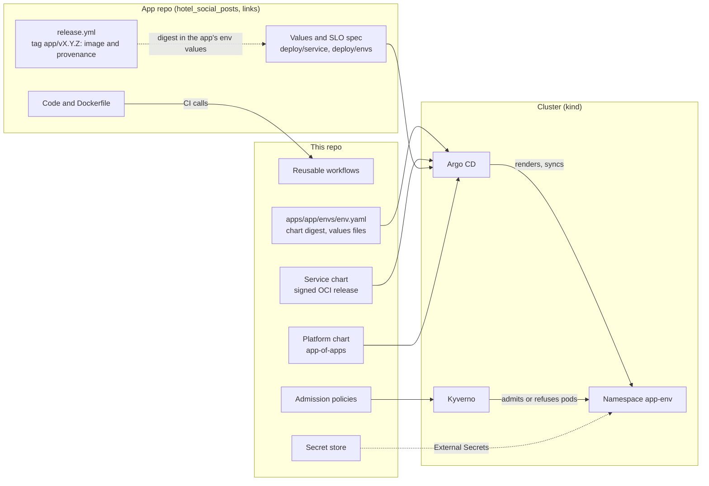
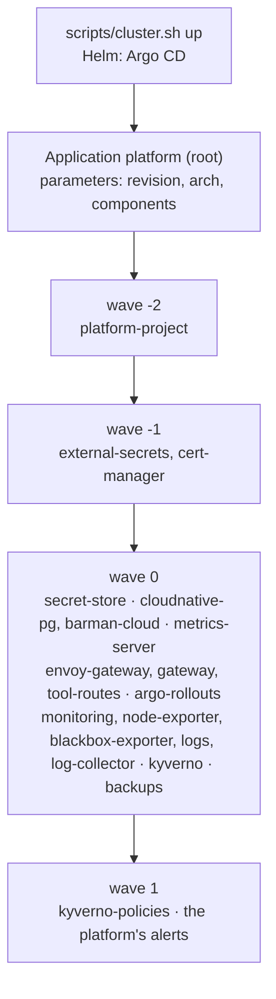
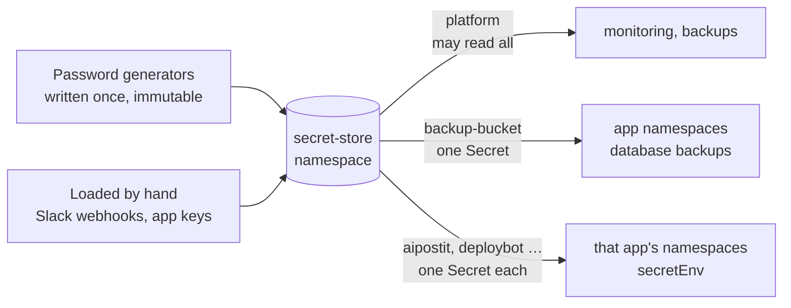

# Platform design

What this repo owns, how its parts fit and why they are shaped this way. How to operate
them is in [RUNBOOK.md](RUNBOOK.md); how to change them is in [CLAUDE.md](../CLAUDE.md).

The platform's parts were designed inside the first app, shortly, and described in its
design doc (links' `apps/shortly/docs/DESIGN.md`). They moved here with platform plan
Phase 3; this is their description, as they are on `main`. An app's own design (its
requests, data, SLOs, capacity, the end-to-end drills its CI runs) stays in the app's repo,
and so do the measurements and incidents behind the choices below, in links' doc.

## Overview

An app team changes its code, its values and the release each environment runs. Everything
else is the platform's: how the app is checked and built, the chart that turns its values
into Kubernetes objects, what the cluster admits, and what runs beside it.

| Part | Where | An app uses it by |
| --- | --- | --- |
| Reusable workflows | `.github/workflows/reusable-*.yml` | Calling them from its CI, pinned by this repo's commit SHA |
| Service chart | `charts/service/` | Its values files; the chart's digest is pinned here, in `apps/<app>/envs/<env>.yaml` |
| The app's environments | `apps/` | A folder, reviewed here |
| Platform chart | `deploy/argocd/platform/` | Nothing to do: it is what the cluster runs beside the app |
| Admission policies and the deploy gate | `deploy/policies/`, `scripts/verify-image.sh` | Releasing from its own `release.yml` at an `<app>/vX.Y.Z` tag |
| Secret store | `deploy/secrets/` | `secretEnv` and `database.cluster` in its values |

**The repo is an API.** Apps pin this repo's commits (workflows; links' `platform.lock`)
and the chart's digests, so a change reaches an app only when its pin moves, in a PR whose
CI proves the app on it. A change an app must react to goes expand, migrate, contract,
never in one PR. `main` is never rewritten and a published chart version is never replaced.
What does not wait for a pin is the cluster itself: Argo CD syncs the platform chart, the
policies and `apps/` from `main` within a minute of a merge.

## Reusable workflows

Two `workflow_call` workflows hold the checks every app's CI runs, so a fix to a check is
made once. This repo's own tests run through the first, so it is exercised on every PR here.

| Workflow | Does | Inputs |
| --- | --- | --- |
| `reusable-python-check.yml` | `uv sync --locked` (fails on a stale lock), ruff format and lint, mypy, pytest with a coverage floor | `working-directory` (an app in a domain repo: `apps/<app>`), `coverage-min` (90), `typecheck-paths`, `helm-version`, `fetch-depth` |
| `reusable-image.yml` | Builds the image, scans it with Trivy (HIGH and CRITICAL with a fix available: failing on unfixable ones trains people to ignore the scanner), runs the app's smoke test against it | `context`, `smoke-command` (the image's tag is in `$IMAGE`) |

Both take `run`: with `run: false` the job reports success without doing the work. A
docs-only PR then passes its required checks in seconds; a workflow-level paths filter
would leave them pending forever. The caller decides what counts as docs-only.

**Not here: the release workflow.** A reusable workflow becomes the signer named in the
provenance it attests, and the admission policy and the deploy gate identify a release by
its signer: the app repo's own `release.yml`. So each app repo keeps its release workflow.

Actions are pinned by commit SHA, tokens are least-privilege (`permissions`,
`persist-credentials: false`), and Dependabot keeps the pins fresh.

## The service chart

One Helm chart, `charts/service`, deploys every app. The app's values say what is specific
to it (its name, image, env list, hostnames); the chart's defaults are production-shaped.

| Value | Renders |
| --- | --- |
| (always) | Deployment (`maxUnavailable: 0`, `maxSurge: 1`), Service, startup, liveness (`/healthz`) and readiness (`/readyz`) probes, a `preStop` sleep before SIGTERM, topology spread. Pods run as UID 10001, non-root, read-only root filesystem, no capabilities, seccomp `RuntimeDefault`, no ServiceAccount token |
| `autoscaling`, `podDisruptionBudget` | An HPA on CPU (and no `replicas` on the workload, which would reset the live count at every sync); a PDB when the minimum replica count is above 1. Rendering fails if `maxReplicas × config.dbPoolSize` exceeds `autoscaling.maxDbConnections` |
| `networkPolicy` | Ingress to the app port from `httpFrom`, to the metrics port from Prometheus only; egress to DNS, the database and `extraEgress`, nothing else |
| `gateway` | An HTTPRoute attaching the release to the platform's Gateway by hostname |
| `canary` | An Argo Rollout in place of the Deployment (below) |
| `monitoring` | A ServiceMonitor; from the one `clusterWide` release per cluster (prod), the app's PrometheusRules and dashboards, the platform's SLO dashboard among them |
| `migrations` | A Job running the app's migration command before new pods start; a failure stops the release |
| `database.cluster` | The app's own Postgres on CloudNativePG: a `Cluster` `<release>-db` (never pruned by Argo CD), WAL archived continuously and a base backup hourly to the platform's bucket, network rules both ways. The app reads its URL from the Secret `<release>-db-app` |
| `cronJobs`, `workers` | A CronJob or a Deployment per entry from the release image, with the app's env; labelled apart, so the HPA and the PDB don't count them; a network policy of their own |
| `redis` | A single Redis 8 with an append-only file, reachable only from the chart's own pods; no password: the network policy is the boundary |
| `secretEnv` | An ExternalSecret copying the app's keys from its store into `<release>-env` |

**The env list is the app's.** The chart renders `env` as it is, in order: which variables
an app reads is not the chart's business. Each entry is a template, so it can read
`config.*`, which an environment's file overrides.

**Order under Argo CD.** Sync waves put the secret env and the database first (the
database held until its Cluster is healthy), then the migration, then the app.

**Its behaviour is its golden renders.** `tests/<app>/<env>.golden.yaml` holds what the
chart renders for each fixture (shortly, and minimal apps for each optional part). CI
diffs them, so a refactor must leave them byte for byte the same, and an intended change
shows as the manifests Argo CD will apply, not as template edits.

**Releases.** A `service/vX.Y.Z` tag publishes the chart to
`oci://ghcr.io/easypeasyops/charts/service` with Sigstore provenance, and the GitHub
Release's notes hold its digest (README, Releasing the service chart). Semantic versioning
since 1.0.0: a change an app must react to is a major version (`CHANGELOG.md`). Apps are
pinned by digest, one environment per PR, staging first; `scripts/check-apps.py` verifies in
CI that each pinned digest is a release whose provenance verifies and that the chart
renders with the app's values fetched from its repo.

**SLO rules.** `scripts/gen_slo_rules.py` turns an app's SLO spec into recording rules and
multi-window burn-rate alerts (each needing a minimum of bad events, so a quiet hour can't
page on one slow request), as a values file the chart ships. A generator because the rules
are too repetitive to write by hand, and small enough to need no extra binary or CRD. Its
output's bytes are in every app's goldens, so its dependencies are pinned in the script.
The window is 30 days (the generator accepts no other: the burn-rate factors assume it),
but a rule can only look back as far as Prometheus keeps: 10 days, or less once
`retentionSize` or a fresh volume cuts it (RUNBOOK, Prometheus data). So
`slo:sli_error:ratio_rate30d`, and the "Error budget remaining" built on it, is the error
ratio of the days Prometheus has, not of 30: an incident older than that has left the
budget, which shows it restored. The burn-rate alerts are unaffected (their longest window
is 3 days).

### Canary releases

Probes and a rolling update only stop a release whose pods never become ready. A release
that starts, passes its probes and then fails requests needs a canary: with
`canary.enabled` the Rollout gives the new version each of `weights` (10%, then 50%) of
the Gateway's traffic in turn, and moves on only if analysis passes.

- **Traffic split:** the HTTPRoute has two backends, the stable and canary Services; Argo
  Rollouts sets their weights through its Gateway API plugin, so the split is per request,
  whatever the pod count. Stable pods stay up during the steps: an abort is the weight
  going back to 0.
- **Analysis** runs on the canary's pods only (Prometheus labels each pod's series with
  its pod-template hash), over a 1-minute rate: `traffic` (too little proves nothing, so
  it fails rather than passes), `error-ratio` (5xx share, one bad measurement aborts) and
  the app's `latencyChecks` (p99 per route, coarse on purpose). Thresholds are absolute: a
  comparison against stable needs enough traffic on both sides.
- **Synthetic traffic:** a k6 Job runs beside each analysis step, through the Gateway, with
  the app's script. Part of the analysis, so every canary gets it, whoever started it. A
  prod with real users turns it off.
- **Rollbacks skip the steps** (`rollbackWindow`), and so does a first install.
- **Argo CD and Argo Rollouts share the objects.** The ApplicationSet's template ignores
  the route's weights and the Services' hash selector, or self-heal would undo a canary
  mid-flight.
- Not covered: a problem that shows only at full load or after a long time, and
  migrations, which run before any canary pod and must stay backward compatible.

## Apps under Argo CD

`apps/applicationset.yaml` generates one Application, `<app>-<env>`, per
`apps/<app>/envs/<env>.yaml`. The env file pins the service chart by digest and lists the
values files to layer from the app's repo. So onboarding an app is a folder here, and every
app gets the same template.

- **The platform owns how, the app owns what.** The chart and its pin are here; the values
  and the image digest are in the app's repo, read from its `main`. Promoting a release is
  a PR there; moving a chart version is a PR here.
- **The namespace comes with the Application.** Argo CD creates `<app>-<env>` with the
  restricted Pod Security Standard enforced, the labels `easypeasyops.github.io/app` and
  `/env`, and its baseline, `deploy/app-namespace/` (default-deny ingress).
- **Everything that serves every app selects namespaces by that label:** the admission
  policies, the Gateway's app listener, the bucket's store, each app's own store. A new app
  needs no edit there. A label added to the template reaches an existing namespace only at
  its Application's next sync, and doesn't trigger one: sync, and check
  `kubectl get ns -l <label>`, before anything selects by it (platform #61 didn't, and
  shortly's front door was down for 3 minutes).
- **Least privilege per app.** `apps/<app>/project.yaml` is the app's AppProject: the
  service chart, its repo and this one as sources; its namespaces as destinations; and no
  cluster-scoped kind except those namespaces, by name.
- **Auto-sync, prune and self-heal:** git is the only way in, a hand edit is reverted,
  and a revert of the PR is the rollback. The ApplicationSet leaves `syncPolicy` alone once
  an Application exists, so break glass (auto-sync off on one Application) still works.
- **Deleting never deletes the app:** no finalizers, and `preserveResourcesOnDeletion`.

Pull, not push: the cluster needs no credentials in CI, and drift is corrected, not just
avoided. Argo CD polls GitHub (a laptop can't receive a webhook), so a merge lands within
about a minute.

## The platform chart

`deploy/argocd/platform/` is a Helm chart whose templates are Argo CD Applications
(app-of-apps), one per platform component. `scripts/cluster.sh up` installs Argo CD with
Helm, applies the platform root and the apps root, and waits; nothing else is put in the
cluster by hand.

| Choice | Why |
| --- | --- |
| The root is a Helm chart | Git can't know a cluster's CPU architecture (the Argo Rollouts plugin is a per-architecture binary), which commit CI is testing, or which components a small cluster skips. They are Helm parameters, set by `cluster.sh` |
| Upstream charts pulled by digest from OCI, values in git beside them | The version says what it is, the digest that it can't change; `tests/test_platform.py` checks each version still resolves to its digest. Values are `deploy/kind/*-values.yaml`, read at the root's revision |
| Waves by what a child needs | The AppProject before the children it limits; External Secrets and cert-manager before the charts that read their Secrets and certificates; the policies and the Argo CD alerts after the slow charts whose webhook and CRDs they need. What needs only fast CRDs (the Gateway) stays in wave 0 and lets the sync retry cover the race |
| Retries order a fresh cluster | A child that has never synced doesn't hold its wave, so on a new cluster all are created at once; one whose dependency isn't ready fails and retries with a short backoff |
| A `platform` AppProject, kept from git | The platform must create CRDs, ClusterRoles and webhooks; apps must not. Neither project may deploy into the other's namespaces |
| No finalizer on the children | Deleting a child, or the root, orphans its resources instead of deleting the monitoring stack or the admission webhook |
| Server-side apply and diff | Several charts' CRDs are too big for client-side apply, and fields other controllers write (webhook CA bundles) are not drift |
| Argo CD not under itself | A bad change to it from git could take down the thing that would fix it. Its pin is in `cluster.sh`; a change to its values needs `cluster.sh up` |
| metrics-server vendored | The release manifest, byte for byte, with its SHA-256; a kustomize patch adds the kind-only flag |

What the children are for:

- **Front door.** One Gateway (Gateway API, served by Envoy Gateway), routed by hostname.
  Gateway API rather than Ingress because weighted backends are in the spec, which the
  canary needs. Two listeners: `http` admits routes from app namespaces only, `tools`
  (Argo CD, Grafana, Prometheus, Alertmanager, on its own port) from `argocd` and
  `monitoring` only, so no namespace can capture another's hostname and no tool is reachable
  on the users' listener. On the laptop, forwarder containers beside the kind node publish
  both on 127.0.0.1; they outlive releases and sleep, which a `kubectl port-forward` doesn't.
- **Monitoring and logs.** kube-prometheus-stack: the operator's CRDs make scraping, rules
  and dashboards part of each app's chart. Alertmanager routes by namespace to Slack.
  VictoriaLogs keeps every pod's log lines, sent by a collector, and the cluster's events,
  which an exporter writes as its own log lines (the API server keeps them an hour; no
  second way into the store); node-exporter reports the
  node's CPU, memory and disk. Those two read the node's files, so each runs alone in a
  namespace of its own, the only two at Pod Security `privileged`. Argo CD is scraped and alerted on too (tickets,
  not pages): with GitOps, a sync that silently stops is a deploy that silently never
  happens. So is the log pipeline: logs that stop arriving fail nothing either, until the
  day they are needed. And External Secrets (warnings): a sync that fails leaves a stale
  Secret and no error. And cert-manager (warnings): a renewal that fails leaves a
  certificate that works until the day it expires. And Kyverno (warnings): with its one
  admission pod down, no Pod can be created in an app's namespace. And CloudNativePG
  (warnings): its operator down, or a database whose last base backup is over a day old,
  for every app's database from one rule rather than one per app. And Argo Rollouts
  (warnings): its controller down, or a canary aborted by an analysis that errored (it
  couldn't measure) rather than failed, the platform's to fix. And a route with no
  backend, read from the HTTPRoute's status through kube-state-metrics (custom resource
  state) rather than from Envoy: the proxy counts its own 5xx per listener only, and only
  when someone asks, while the status names the route and kube-state-metrics already runs.
  The dashboards' deploy marks are read the same way, from each Argo CD Application's last
  sync: Argo CD's own metrics name no revision, and this needs no Grafana API token, which
  Argo CD's notifications into Grafana would. Details: RUNBOOK.
- **Databases and backups.** CloudNativePG runs each app's Postgres from the `Cluster` its
  chart renders: failover, base backups and point-in-time recovery from an operator
  instead of a hand-rolled StatefulSet and dumps. Backups go through the Barman Cloud
  plugin, which talks to the operator over mutual TLS (hence cert-manager), to a bucket in
  its own namespace (SeaweedFS in kind), reachable only by backup and restore pods.
- **Argo Rollouts**, with its Gateway API traffic-router plugin, pinned by version and
  checksum. Upstream publishes no checksums: ours were computed when pinned, which guards
  against a later swap, not a bad original.

## Admission policies and the deploy gate

Two layers enforce one rule, that our images run only as releases:

1. **`scripts/verify-image.sh`**, the deploy gate an app's deploy and promote scripts run:
   a clear error before anything changes.
2. **Kyverno**, at the API server: the same rule for every other path (`kubectl`, a
   compromised laptop, a hand-edited digest).

The rule is keyed by identity, not by a list of apps. An image
`ghcr.io/easypeasyops/<repo>/<app>` must be referenced by digest and carry SLSA provenance
signed (Sigstore, keyless, logged in Rekor) by `easypeasyops/<repo>`'s `release.yml`
running at an `<app>/vX.Y.Z` tag. So CI builds, forks and branches don't qualify, one repo
can't vouch for another's images nor one app for another's, and a new app is covered with
no policy edit. `tests/test_admission_policies.py` runs the policies through the Kyverno
CLI (offline cases and the real registry) and asserts the gate and the policy agree.

| Policy | Rule | In kind |
| --- | --- | --- |
| `require-release-provenance` (ImageValidatingPolicy) | The rule above, for every container of a Pod (init and ephemeral included) in an app namespace, and for the Pod templates of Deployments, StatefulSets, Jobs, CronJobs, ReplicaSets and DaemonSets | Deny |
| `app-allowed-images` (ValidatingPolicy) | Pods in an app's namespaces run only that app's release, or the images the chart and its drills bring: Postgres 17, Redis 8, k6, CloudNativePG's | Audit |

- **They need each other.** The first looks only at our images, so alone it is dodged by
  running some other image; the second closes that. It is Audit in kind because local
  builds are how the cluster is developed; on a real cluster it is Deny.
- **Tags are refused, not resolved** (`mutateDigest: false`): what was verified is what runs.
- **Fail closed.** The gate refuses without `gh`, the network or an attestation; the
  policy's webhook refuses new Pods if Kyverno, the registry or Rekor can't be reached.
  Running pods are not affected. `INSECURE_SKIP_VERIFY=1` skips the gate only, loudly.
- **Admission only, never in the background.** Kyverno's reports controller otherwise
  re-verifies every running image against the registry and Rekor, which cost about a core
  on the kind node and slowed every request. An image can't change after admission.
- **Kyverno ImageValidatingPolicy (CEL)** rather than Sigstore's policy-controller: Kyverno
  also runs the allowlist, and its CLI tests the same engine offline.

A policy change says in its PR which images it newly admits or refuses.

## The secret store

No secret is in git, and none is made by a script. The `secret-store` namespace holds the
source of every secret; External Secrets copies each to where it is used.

| Choice | Why |
| --- | --- |
| A store inside the cluster (External Secrets' Kubernetes provider) | No secrets server to run, unseal or back up on a laptop. A real cluster points the ClusterSecretStores at a secret manager and no consumer changes |
| Several ClusterSecretStores, each with its own reader | A store's conditions say which namespaces may use it, not which Secret each may read. So what the app namespaces can reach is bounded by the reader's Role: `backup-bucket` may get the bucket's keys only, an app's store that app's one Secret only, and only namespaces labelled with that app may use it |
| Generated values written once, into an immutable Secret | `refreshPolicy: CreatedOnce` so a resync never rotates a password everything uses; `immutable: true` because a recreated ExternalSecret's first sync would otherwise overwrite it silently. A value is replaced only by deleting it |
| Consumers derive the rest | The ExternalSecret beside the chart that reads it templates the user name or config file around the stored value, and syncs before the workload |
| Loaded by hand what can't be generated | A Slack webhook or an app's API key comes from somewhere else: `scripts/load-app-env.sh` and RUNBOOK say how, and the value never passes through git, chat or a ticket. Nothing the platform needs to come up may wait on one: Slack is wired only where `cluster.sh` finds the webhooks in the store (`components.slack`), so a fresh cluster installs without them |

The database's credentials are not here: CloudNativePG generates them into the app's
namespace. `tests/test_secret_store.py` checks each reader's reach and that `cluster.sh`
makes no platform secret.

## Checks

What a schema can check, kubeconform checks on every manifest and on the platform chart
rendered three ways. What it can't, `tests/` does: pinning, namespaces and labels, ports,
policy verdicts, the deploy gate, alert routes. The chart has its goldens and a release
rehearsal against a throwaway registry on every PR. One job, `ci`, needs all the others and
is the only required check, so jobs can be split or renamed without a ruleset change.

What this repo can't check is an app running on a new platform: the kind end-to-end test
is in the app's repo, against the platform commit it pins.

## Known limitations

- Local kind only. The values under `deploy/kind/` and several names (the Gateway
  `shortly`, the cluster) still carry the first app's name.
- The allowlist policy is Audit in kind, so an unknown image in an app namespace is
  reported, not refused. Provenance is checked at admission: a policy change doesn't evict
  running pods.
- One Kyverno admission replica: while it restarts, no Pod can be created in an app
  namespace.
- The bucket runs in the cluster it backs up, on the same node, and every app's database
  shares one bucket identity: separation of credentials and network, not of failure domains.
- The secret store is Kubernetes Secrets in one namespace: whoever may read Secrets there
  reads every platform and app secret.
- One replica of each Argo CD component, admin login, no SSO; the tools' listener has no
  login of its own and is bound to 127.0.0.1.
- Argo Rollouts' Gateway API plugin is alpha. Canary analysis judges synthetic traffic
  against absolute thresholds.
